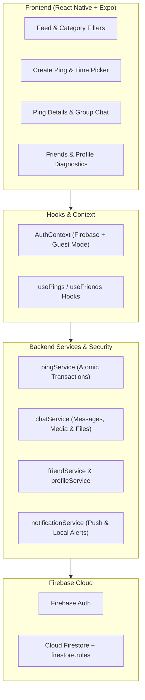

# PingMe

### Spontaneous Activity Coordination & Real-Time Social Pings

<p align="center">
  
</p>

<p align="center">
  <strong>A fast, minimal mobile & web workspace to broadcast spontaneous plans, see who's free, and coordinate without group chat chaos.</strong>
</p>

<p align="center">
  
  
  
  
  
  
</p>

<p align="center">
  <a href="https://github.com/mausam-005/PingMe/releases/latest">
    
  </a>
  <a href="https://github.com/mausam-005/PingMe">
    
  </a>
</p>

<p align="center">
  <sub>Android · iOS · Web · Open Source</sub>
</p>

---

## Highlights

- **Spontaneous Activity Pings:** Create custom plans (or pick quick ideas like *Coffee*, *Sports*, *Study*, *Walk*, *Food*, *Gaming*) with notes, locations, and group capacity limits (`2–6` spots).
- **Flexible Time Pinning:** Broadcast **Now** or schedule an exact **Start / End Time** using native OS clock pickers on Android/iOS and native time inputs on Web.
- **Concurrency-Safe Atomic Joins:** Uses Firestore transactions (`runTransaction`) so activities never exceed their maximum participant count.
- **Scoped Activity Group Chat:** Dedicated group chat for each ping's host and joined members with real-time text messages, camera/gallery photos, and document/file sharing.
- **Friendship Graph:** Search users by `@username`, send friend requests, and accept or decline invites.
- **Responsive Cross-Platform UI:** Obsidian dark theme with warm bronze gradients (`expo-linear-gradient`), Reanimated spring micro-interactions, and centered responsive layout across phones and web browsers.
- **Zero-Friction Guest Mode:** Instant offline/in-memory preview mode alongside full Firebase Auth & Firestore persistence.

---

## Architecture

PingMe separates the React Native UI (`frontend/`) from Firebase data services and security rules (`backend/`).



---

## Getting Started

### Download for Android

<p align="center">
  <a href="https://github.com/mausam-005/PingMe/releases/latest">
    
  </a>
</p>

1. Open the [**latest PingMe release**](https://github.com/mausam-005/PingMe/releases/latest).
2. Download the `.apk` file from the release assets on your Android phone.
3. Allow installation from your browser/file manager if prompted, then install **PingMe**.

### Run from Source

#### Prerequisites

- [Node.js](https://nodejs.org/) `v18.0.0` or higher
- npm `v9.0.0` or higher
- Expo Go app (for mobile preview) or a web browser

#### Quick Start

```bash
git clone https://github.com/mausam-005/PingMe.git
cd PingMe
npm install

# Start Metro bundler (scan QR with Expo Go)
npx expo start -c

# Or launch directly in Web browser:
npm run web
```

#### Connect Your Firebase Project

1. Create a project in the [Firebase Console](https://console.firebase.google.com/).
2. Enable **Authentication → Email/Password** and **Cloud Firestore**.
3. Paste your web app config keys into `backend/firebase.js`.
4. Deploy `backend/firestore.rules` under **Firestore Database → Rules**.

### Build a Downloadable Android APK

```bash
npm install -g eas-cli
eas login
eas build:configure
eas build -p android --profile preview
```

---

## Device APIs & Native Capabilities

| Device API | How It Is Used in PingMe |
|---|---|
| `expo-image-picker` (`Camera` & `Gallery`) | Captures live photos or selects images for profile avatars and group chat. |
| `expo-document-picker` | Attaches and shares PDFs, documents, and files inside activity group chats. |
| `expo-notifications` | Requests `POST_NOTIFICATIONS` / push permissions, fetches device tokens, and triggers local alerts. |
| `expo-haptics` | Provides tactile feedback when creating, joining, or messaging in pings. |
| `@react-native-community/datetimepicker` | Opens native Android clock dials and iOS time wheels when scheduling pings. |
| `Share.share` (React Native) | Opens the native OS share sheet for ping invites and shared files. |
| `@react-native-async-storage/async-storage` | Persists Firebase Auth sessions locally across app restarts. |

---

## Project Structure

```text
PingMe/
├── assets/
│   ├── adaptive-icon.png         # Android adaptive foreground icon
│   ├── favicon.png               # Web favicon
│   ├── icon.png                  # Application icon
│   ├── notification-icon.png     # Android notification icon
│   └── splash.png                # Launch splash screen
├── backend/
│   ├── chatService.js            # Group chat messages, images & file metadata
│   ├── firebase.js               # Firebase initialization & AsyncStorage persistence
│   ├── firestore.rules           # Cloud Firestore security rules
│   ├── friendService.js          # Username search, friend requests & friendships
│   ├── notificationService.js    # Push token registration, diagnostics & local alerts
│   ├── pingService.js            # Ping CRUD, atomic join/leave transactions & feeds
│   └── profileService.js         # User profile reads & updates
├── frontend/
│   ├── components/
│   │   ├── Avatar.js             # Initials or image user avatar
│   │   ├── GradientSurface.js    # Cross-platform expo-linear-gradient wrapper
│   │   ├── Icons.js              # Custom vector SVG icon set
│   │   ├── Logo.js               # PingMe radar beacon mark & brand lockup
│   │   ├── PingCard.js           # Responsive activity card with live capacity bar
│   │   ├── PrimaryButton.js      # Spring-animated multi-variant button
│   │   └── UI.js                 # StyledInput, EmptyState & SkeletonCard
│   ├── context/
│   │   └── AuthContext.js        # Firebase Auth & guest session provider
│   ├── hooks/
│   │   ├── useFriends.js         # Live friend IDs, profiles & request hooks
│   │   └── usePings.js           # Live feed, created & joined ping hooks
│   ├── navigation/
│   │   └── RootNavigator.js      # Auth stack, 5-tab navigator & modal routes
│   ├── screens/
│   │   ├── auth/                 # WelcomeScreen, LoginScreen, RegisterScreen
│   │   ├── create/               # CreatePingScreen
│   │   ├── friends/              # FriendsScreen
│   │   ├── home/                 # FeedScreen, PingDetailsScreen, PingChatScreen
│   │   ├── pings/                # MyPingsScreen
│   │   └── profile/              # ProfileScreen, EditProfileScreen
│   ├── theme/
│   │   └── index.js              # Obsidian dark theme & warm brown gradient tokens
│   └── utils/
│       └── alert.js              # Cross-platform Alert / Confirm helper
├── App.js                        # Root entry point & notification listeners
├── app.json                      # Expo config, permissions & plugins
├── babel.config.js               # Babel & Reanimated plugin config
├── metro.config.js               # Metro bundler config (.cjs & Firebase ESM resolution)
├── package.json
├── package-lock.json
├── .gitignore
├── .npmrc
└── README.md
```

---

<details>
  <summary><strong>Technical Reference: Backend Services & Firestore Data Model</strong></summary>

### Backend Services

- `pingService.js`: `createPing`, `joinPing` (atomic transaction), `leavePing`, `closePing`, `subscribeFriendsFeed`, `subscribeMyPings`, `subscribeJoinedPings`
- `chatService.js`: `sendChatMessage` (`text`, `image`, `file`), `subscribePingChat`
- `friendService.js`: `searchUsersByUsername`, `sendFriendRequest`, `acceptFriendRequest`, `rejectFriendRequest`, `removeFriend`, `subscribeFriendIds`, `subscribeIncomingRequests`, `subscribeOutgoingRequests`
- `profileService.js`: `updateUserProfile`, `getUserProfile`
- `notificationService.js`: `registerForPushNotifications`, `getNotificationDiagnostics`, `sendLocalNotification`

### Firestore Collections

- `users/{uid}`: `uid`, `name`, `username`, `email`, `bio`, `photoURL`, `expoPushToken`, `createdAt`
- `pings/{pingId}`: `ownerId`, `activity`, `emoji`, `description`, `scheduledAt`, `expiresAt`, `timeWindow`, `locationText`, `maxParticipants`, `participantIds`, `participantNames`, `participantCount`, `status`, `createdAt`
- `pings/{pingId}/messages/{msgId}`: `senderId`, `senderName`, `type` (`text` | `image` | `file`), `text`, `mediaUri`, `fileName`, `fileSize`, `timeLabel`, `createdAt`
- `friendRequests/{reqId}`: `senderId`, `receiverId`, `status` (`pending` | `accepted`), `createdAt`
- `friendships/{friendshipId}`: `userIds`, `user1`, `user2`, `createdAt`

</details>

---

## License

MIT — [Mausam](https://github.com/mausam-005)
